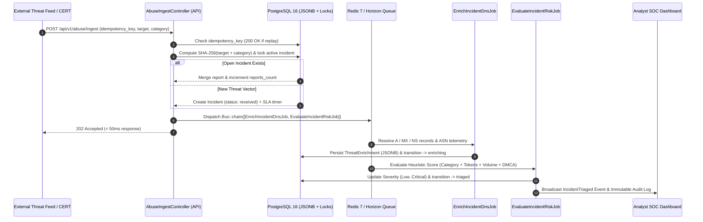

# 🛡️ SentinelDesk — Automated Abuse Desk, DMCA & Threat Triage Engine

**SentinelDesk** is an event-driven Abuse Desk, DMCA compliance, and Threat Intelligence triage platform built with **Laravel 11/12 (PHP 8.4)**, **PostgreSQL 16 (`JSONB`)**, **Redis 7**, **Laravel Horizon**, and **Laravel Reverb**.

Designed around real-world hosting & cloud security operations (SOC / Abuse Desk), SentinelDesk ingests high-volume abuse webhooks, enforces **strict idempotency**, deduplicates multi-source reports via **SHA-256 fingerprinting**, enriches targets asynchronously with live DNS/ASN telemetry, computes an explainable **Heuristic Risk Score (0–100)**, and governs incident resolution through an **auditable State Machine**.

---

## 🏗️ System Architecture & Asynchronous Triage Pipeline



---

## ✨ Key Engineering Highlights

| Capability | Implementation Details |
| :--- | :--- |
| **Idempotent Webhook Ingestion** | Prevents duplicate database writes during upstream webhook retries using unique `idempotency_key` tracking (`200 OK` replay vs `202 Accepted` new ingestion). |
| **Atomic SHA-256 Deduplication** | Normalizes target domains/IPs/URLs and computes a deterministic `SHA-256(target\|category)` fingerprint with pessimistic row locking (`SELECT ... FOR UPDATE`) to merge concurrent abuse bursts into a single incident. |
| **Async DNS & Risk Scoring Pipeline** | Uses `Bus::chain` on Redis to decouple HTTP ingestion from network I/O (`dns_get_record`) and multi-factor heuristic risk calculation (`0–100` score with human-readable explanations). |
| **Backed Enum State Machine** | Strictly typed PHP 8.4 Enums (`IncidentStatus`, `AbuseCategory`, `IncidentSeverity`) enforce valid lifecycle transitions (`received` → `enriching` → `triaged` → `investigating` → `awaiting_customer` → `mitigated`/`dismissed`) and dynamic SLA deadlines. |
| **Immutable Forensic Audit Trail** | Every state transition, merged report, and analyst mitigation action is atomically recorded in `incident_audit_logs` with actor attribution, IP address, and `JSONB` state diffs. |
| **1-Click Recruiter Demo & Webhook Simulator** | Includes a zero-friction **1-Click Recruiter Demo Login** and an interactive **Live Webhook Simulator** to trigger Phishing, WP Malware, DMCA, and DDoS payloads directly from the browser. |

---

## 🚀 Quick Start (Docker Compose)

```bash
# 1. Clone the repository
git clone https://github.com/YOUR_USERNAME/sentineldesk.git
cd sentineldesk

# 2. Build and start Nginx, PHP 8.4-FPM, PostgreSQL 16, and Redis 7
docker compose up -d --build

# 3. Run migrations and seed realistic Abuse Desk incidents
docker compose exec app php artisan migrate:fresh --seed

# 4. Run the automated test suite (PHPUnit / Feature & Domain tests)
docker compose exec app php artisan test --filter=AbuseTriagePipelineTest
```

Open **`http://localhost:8080`** in your browser and click **⚡ 1-Click Recruiter Demo Login**.

---

## 🔌 API Reference: Ingest Abuse Report

### `POST /api/v1/abuse/ingest`

```bash
curl -s -X POST http://localhost:8080/api/v1/abuse/ingest \
  -H "Content-Type: application/json" \
  -H "Accept: application/json" \
  -d '{
    "idempotency_key": "phishlabs-2026-0001",
    "target_type": "domain",
    "target_value": "secure-login-update-bank.example.com",
    "category": "phishing",
    "reporter_email": "soc@phishlabs.example.org",
    "reporter_organization": "PhishLabs SOC"
  }'
```

#### Response (`202 Accepted`):
```json
{
  "message": "New incident created and queued for asynchronous threat enrichment.",
  "idempotent_replay": false,
  "deduplicated_into_existing_incident": false,
  "incident_reference": "SD-2026-00104",
  "reports_count": 1,
  "status": "received"
}
```

---

## 🧪 Automated Test Coverage

Run the test suite inside the `app` container:

```bash
docker compose exec app php artisan test --filter=AbuseTriagePipelineTest
```

- `test_it_ingests_new_abuse_report_and_queues_enrichment_pipeline`
- `test_it_enforces_strict_idempotency_on_duplicate_webhook_replays`
- `test_it_deduplicates_multiple_reports_for_same_target_via_sha256_fingerprint`
- `test_async_jobs_enrich_dns_and_calculate_critical_heuristic_risk_score`
- `test_state_machine_blocks_invalid_transitions_and_records_immutable_audit_trail`

---

## 👨‍💻 Author

**Claudio Leiva** — Systems & Infrastructure Specialist / Backend & Technical Support Engineer  
*Built to showcase Abuse Desk automation, DMCA compliance workflows, and resilient backend architecture.*
